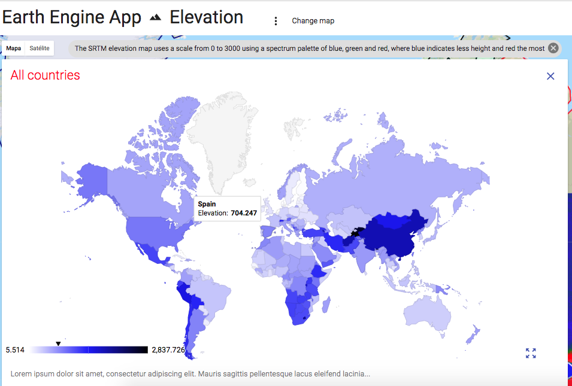
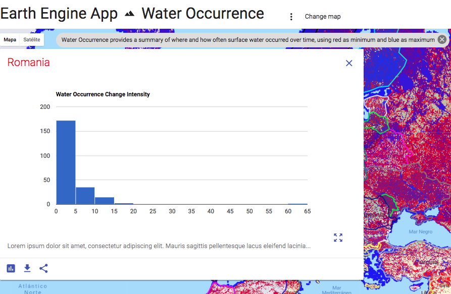
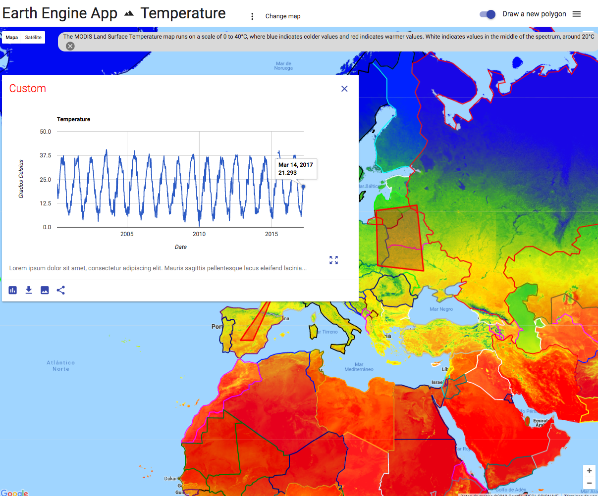

# Earth Engine App

---

Create dynamic maps using Google Earth Engine to study temperature, vegetation, elevation, deforestation and water occurrence and change of any country or your custom zone of interest.







## Installation and Usage
Update `config.py` with your Earth Engine service account, credentials file, Google Cloud project ID, and Maps API key. The project must have Earth Engine enabled and the service account must have access.

### Install python dependencies
```sh
python3 -m venv .venv
source .venv/bin/activate
python -m pip install -r requirements.txt
```

### Execute app
```sh
python main.py
```
Your app will be live on http://localhost:8080

### Build and test
```sh
npm ci
npm run build
npm test
python -m unittest test_app -v
```

Offline tests mock Earth Engine network calls. For browser tests, install `requirements-dev.txt`, start the configured app, install Chrome, and run `python tests.py`. Selenium manages the Chrome driver. Tiles are fetched through the server with the service account; credentials stay on the server and the tile proxy works across workers. Live map tiles and dataset access require valid Google credentials and cannot be verified by offline tests.

## Requirements
- Python 3.10+ (3.12 recommended).
- Node.js 22.12+ for rebuilding frontend assets.
- Pip

[Apache 2.0 License](LICENSE.txt)

---